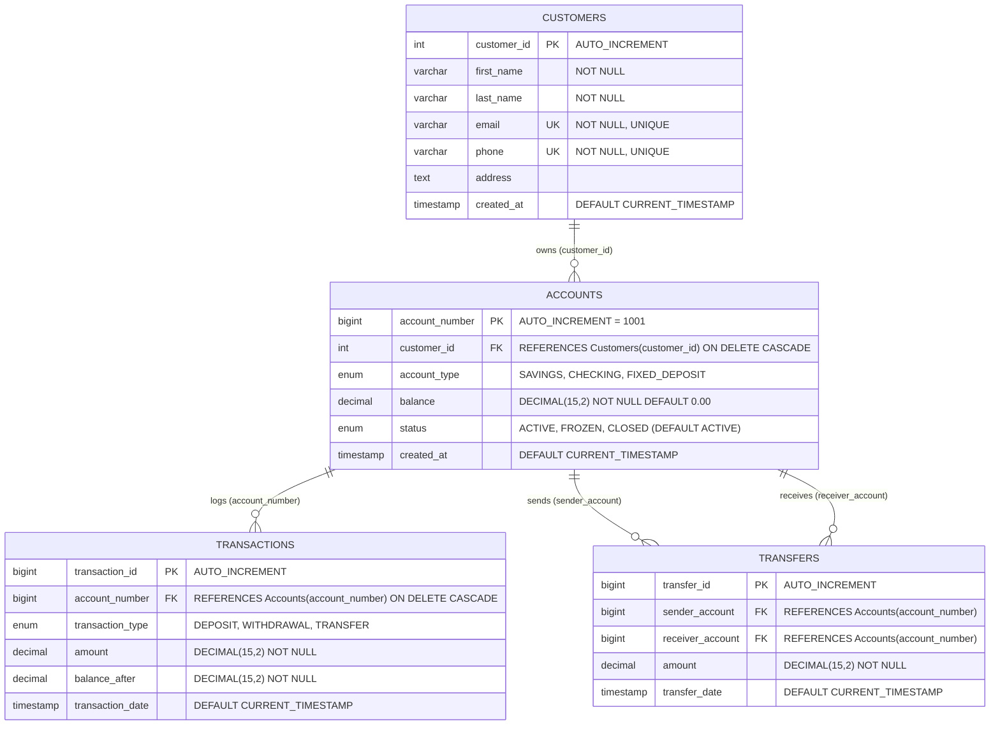

# 🏦 Horizon Bank Management System

[](https://nodejs.org/)
[](https://expressjs.com/)
[](https://www.mysql.com/)
[-059669?style=flat)](https://en.wikipedia.org/wiki/Indian_rupee)
[]()
[](https://vercel.com/)
[](https://opensource.org/licenses/ISC)

A full-stack, enterprise-grade **Bank Management System** built for the **Database Management Systems (DBMS)** academic curriculum. Developed with **MySQL 8.0**, **Node.js (Express)**, and a modern **Glassmorphic Institutional Dark UI**, the platform showcases relational database design, automated ledger auditing via **MySQL Triggers**, **ACID-compliant atomic transfers**, and a **resilient cloud demo fallback engine** for serverless deployments.

---

## 👥 Project Team & Academic Credentials

**Course:** Database Management Systems (DBMS Evaluation)  
**Academic Year:** 2026  
**Institution:** Academic DBMS Evaluation Project  

### 🎓 Team Members

- 👤 **Juilee Bade** (Roll No: `03`)
- 👤 **Hari Bhambhani** (Roll No: `04`)
- 👤 **Vedant Bhangale** (Roll No: `05`)
- 👤 **Tejas Chaudhari** (Roll No: `07`)

---

## 🚀 Live Access & Quick Links
- **Live Demo:** [Website](bankdb-eta.vercel.app)
- **Web Dashboard:** [http://localhost:5000](http://localhost:5000)
- **API Health Check:** [http://localhost:5000/api/health](http://localhost:5000/api/health)
- **Dashboard Stats:** [http://localhost:5000/api/dashboard/stats](http://localhost:5000/api/dashboard/stats)
- **Database Engine:** `MySQL 8.0 (BankManagementDB on 127.0.0.1:3306)` with automated In-Memory Cloud Fallback

---

## 📌 Architecture & Relational Database Design

The relational database matches the formal **Enhanced Entity-Relationship (EER) Diagram** with 4 interconnected tables, enforcing referential integrity, unique constraints, and cascade policies.



### Relational Schema Specifications

1. **`Customers`**: Master customer entity holding verified contact credentials (`email` and `phone` are unique keys).
2. **`Accounts`**: Financial accounts linked via `customer_id` Foreign Key. Auto-increments starting at `1001` for realistic account numbers. Supports `SAVINGS`, `CHECKING`, and `FIXED_DEPOSIT` accounts, with status flags (`ACTIVE`, `FROZEN`, `CLOSED`).
3. **`Transactions`**: Immutable financial ledger tracking all balance modifications with pre-computed `balance_after`. Populated automatically via database triggers.
4. **`Transfers`**: Dedicated dual-entry log recording inter-account transfers between sender and receiver accounts.

---

## ⚡ Automated Database Trigger: `after_account_update`

To enforce financial auditing and zero data drift, ledger records are **never manually duplicated** in application code. Instead, MySQL automatically executes this database trigger whenever an account's balance updates:

```sql
DELIMITER $$
DROP TRIGGER IF EXISTS after_account_update$$
CREATE TRIGGER after_account_update
AFTER UPDATE ON Accounts
FOR EACH ROW
BEGIN
    IF NEW.balance <> OLD.balance THEN
        INSERT INTO Transactions (account_number, transaction_type, amount, balance_after)
        VALUES (
            NEW.account_number, 
            IF(NEW.balance > OLD.balance, 'DEPOSIT', 'WITHDRAWAL'), 
            ABS(NEW.balance - OLD.balance), 
            NEW.balance
        );
    END IF;
END$$
DELIMITER ;
```

### Why this matters in DBMS:
- **Zero Ledger Drift:** Impossible to modify an account balance without an immediate, immutable transaction entry.
- **Audit-Proof Accounting:** Both direct deposits/withdrawals and inter-account transfers generate timestamped audit records automatically.
- **Encapsulated Business Logic:** The database engine maintains financial invariants independently of the caller application.

---

## 🔒 ACID-Compliant Atomic Transfers

Inter-account fund transfers are executed using strict **ACID transactions** to prevent double-spending, race conditions, or partial debits:

```
           [ Client Requests Transfer: Sender -> Receiver ]
                                  │
                                  ▼
                     await connection.beginTransaction()
                                  │
               ┌──────────────────┴──────────────────┐
               ▼                                     ▼
     Lock Sender Account                   Lock Receiver Account
  (SELECT ... FOR UPDATE)               (SELECT ... FOR UPDATE)
               │                                     │
    [ Validate Sender Active              [ Validate Receiver Active
      & Balance >= Amount ]                  & Receiver Exists ]
               │                                     │
               └──────────────────┬──────────────────┘
                                  │ (Validation Passed)
                                  ▼
                1. UPDATE Accounts (Debit Sender)
                   ↳ Triggers 'WITHDRAWAL' audit row in Transactions
                2. UPDATE Accounts (Credit Receiver)
                   ↳ Triggers 'DEPOSIT' audit row in Transactions
                3. INSERT INTO Transfers (Audit sender & receiver link)
                                  │
                                  ▼
                      await connection.commit()
                        (or rollback() on error)
```

1. **Atomicity:** All debits, credits, and transfer logs commit together. If any check fails, `connection.rollback()` reverts all modifications.
2. **Consistency:** Account balances strictly satisfy `balance >= 0` and total liquidity is conserved.
3. **Isolation:** Row-level locks (`SELECT ... FOR UPDATE`) prevent concurrent updates or race conditions during in-flight transfers.
4. **Durability:** Committed transactions are immediately persisted to MySQL disk storage or resilient state.

---

## 🔄 Dual Database Mode (Hybrid Real MySQL + Resilient Cloud Fallback)

Horizon Bank features an intelligent, resilient database proxy architecture (`src/config/db.js`):

- **Local / Self-Hosted Environment:** Connects directly to **MySQL 8.0** via a pooled connection (`mysql2/promise`), verifying tables and executing native SQL queries and triggers.
- **Serverless / Cloud Deployment (Vercel):** When deployed on cloud platforms where a local MySQL daemon is not running, or if connection errors occur (`ECONNREFUSED`, `ENOTFOUND`, `ETIMEDOUT`), the system **automatically activates an In-Memory Database Engine (`src/config/mockDb.js`)**.
- **Zero Cold Crashes:** In Cloud Demo Mode, all customer registrations, account creations, deposits, withdrawals, and ACID transfers remain **100% interactive and functional**, emulating MySQL trigger behavior in memory with pre-seeded demo records.

---

## 💻 Tech Stack

| Layer | Technology | Description |
| :--- | :--- | :--- |
| **Database** | **MySQL 8.0** | Relational engine with foreign keys, cascading deletes, and triggers |
| **DB Driver** | **mysql2/promise** | High-performance connection pooling with async/await support |
| **Backend** | **Node.js & Express 5** | RESTful routing, input validation, and transactional controllers |
| **Fallback Engine** | **Custom In-Memory SQL Mock** | High-fidelity SQL emulator for serverless cloud demo hosting |
| **Frontend UI** | **Vanilla HTML5 & CSS3** | Modern institutional dark theme with glassmorphic cards and modals |
| **Frontend Logic** | **Vanilla JavaScript (ES6 Modules)** | Asynchronous API client, DOM rendering, modal controller |
| **Localization** | **Indian Rupees (INR - ₹)** | Standardized currency notation across UI cards, tables, and forms |
| **Typography & Icons** | **Plus Jakarta Sans, JetBrains Mono, FontAwesome 6** | Premium institutional styling and iconography |
| **Cloud Hosting** | **Vercel Serverless Ready** | Built-in `vercel.json` rewrites and `api/index.js` entrypoint |

---

## 🌟 Key Application Features

1. **Executive Financial Dashboard:**
   - Real-time KPI summary: Total Liquidity (₹), Active Accounts, Frozen Accounts, Total Customers, and Transfer Volume.
   - Live transaction feed displaying the 6 most recent operations across the bank.
   - Quick-action buttons for instantaneous deposits, withdrawals, transfers, and customer onboarding.

2. **Customer Relationship Management:**
   - Searchable customer directory with live search filter (name, email, phone).
   - Modal to onboard new customers with duplicate-detection validation.
   - Customer portfolio inspector displaying all bank accounts linked to any selected customer.
   - Edit customer contact details or remove customer records (with cascading account cleanup).

3. **Account Portfolio Management:**
   - Full ledger of all accounts with real-time balance formatted in Indian Rupees (`₹`).
   - Filter accounts by status (`ACTIVE`, `FROZEN`, `CLOSED`) and type (`SAVINGS`, `CHECKING`, `FIXED_DEPOSIT`).
   - One-click account status controls: Freeze account, Unfreeze account, or Close account.
   - Direct account actions: Open new account, quick deposit, and quick withdraw.

4. **Immutable Transaction Ledger:**
   - Searchable and filterable financial ledger.
   - Filter by transaction type (`DEPOSIT`, `WITHDRAWAL`, `TRANSFER`) or specific account number.
   - Displays exact amount, historical `balance_after`, customer name, and ISO timestamp.

5. **Inter-Account Transfers Desk:**
   - Dedicated transfer tracking log showing sender account, receiver account, transfer amount (₹), and timestamp.
   - Transfer modal with account validation, self-transfer prevention, and real-time balance verification.

6. **Institutional Dark Theme & Mobile Experience:**
   - Minimal institutional color palette (deep slate, emerald green, and cobalt accents).
   - Fully responsive navigation with a slide-out mobile drawer and touch-friendly controls.
   - Interactive Group Members modal in header displaying the project team and academic credentials.
   - Dynamic database status badge with live ping inspection.

---

## 📡 RESTful API Reference

All responses return standard JSON structures with `{ success: true|false, ... }`.

### 1. System & Dashboard Endpoints

| Method | Endpoint | Description |
| :--- | :--- | :--- |
| `GET` | `/api/health` | Inspects database connection status, ping latency, version, and table count |
| `GET` | `/api/dashboard/stats` | Fetches aggregated KPIs, liquidity metrics, account breakdowns, and recent activity |

### 2. Customers Endpoints

| Method | Endpoint | Parameters / Body | Description |
| :--- | :--- | :--- | :--- |
| `GET` | `/api/customers` | Query: `?search=` | Lists all customers with total account count and aggregated balance |
| `GET` | `/api/customers/:id` | Path: `:id` | Fetches single customer profile along with all associated bank accounts |
| `POST` | `/api/customers` | Body: `{ first_name, last_name, email, phone, address }` | Registers a new customer |
| `PUT` | `/api/customers/:id` | Body: `{ first_name, last_name, email, phone, address }` | Updates customer profile details |
| `DELETE` | `/api/customers/:id` | Path: `:id` | Deletes customer (cascades to linked accounts and transactions) |

### 3. Accounts Endpoints

| Method | Endpoint | Parameters / Body | Description |
| :--- | :--- | :--- | :--- |
| `GET` | `/api/accounts` | Query: `?status=`, `?account_type=`, `?search=` | Lists accounts with customer owner details |
| `GET` | `/api/accounts/:accountNumber`| Path: `:accountNumber` | Fetches details and transaction history for an account |
| `POST` | `/api/accounts` | Body: `{ customer_id, account_type, initial_deposit }` | Creates a new bank account with optional starting balance |
| `PATCH` | `/api/accounts/:accountNumber/status` | Body: `{ status: 'ACTIVE' \| 'FROZEN' \| 'CLOSED' }` | Updates account status |

### 4. Transactions & Transfers Endpoints

| Method | Endpoint | Parameters / Body | Description |
| :--- | :--- | :--- | :--- |
| `GET` | `/api/transactions` | Query: `?accountNumber=`, `?type=`, `?limit=` | Fetches transaction audit ledger |
| `POST` | `/api/transactions/deposit` | Body: `{ account_number, amount }` | Deposits funds into an active account (fires trigger) |
| `POST` | `/api/transactions/withdraw` | Body: `{ account_number, amount }` | Withdraws funds with balance verification (fires trigger) |
| `POST` | `/api/transactions/transfer` | Body: `{ sender_account, receiver_account, amount }` | Performs atomic ACID transfer between two accounts |
| `GET` | `/api/transactions/transfers` | None | Lists historical inter-account transfer records |

---

## 📂 Project Directory Structure

```
DBMS project/
├── .env                         # Local environment configuration (DB credentials & PORT)
├── .env.example                 # Environment template for new setups
├── .gitignore                   # Git ignore specifications
├── api/
│   └── index.js                 # Vercel serverless entrypoint
├── Database.sql                 # MySQL schema (DDL), triggers, and seed data (DML)
├── EER diagram.png              # Entity-Relationship diagram export
├── package.json                 # Project dependencies & startup scripts
├── package-lock.json            # Locked dependency tree
├── server.js                    # Express application entrypoint & middleware setup
├── vercel.json                  # Vercel deployment rewrites & routing rules
├── src/
│   ├── config/
│   │   ├── db.js                # Resilient MySQL connection pool & health checker
│   │   └── mockDb.js            # In-memory database engine for cloud demo mode
│   ├── controllers/
│   │   ├── accountController.js     # Account creation, filtering, and status controls
│   │   ├── customerController.js    # Customer CRUD and multi-account portfolio lookup
│   │   ├── dashboardController.js   # Aggregated analytics and system health metrics
│   │   └── transactionController.js # Deposits, withdrawals, and ACID atomic transfers
│   └── routes/
│       ├── accountRoutes.js         # /api/accounts route definitions
│       ├── customerRoutes.js        # /api/customers route definitions
│       ├── dashboardRoutes.js       # /api/dashboard route definitions
│       └── transactionRoutes.js     # /api/transactions route definitions
└── public/
    ├── index.html               # Main single-page banking dashboard UI
    ├── css/
    │   └── style.css            # Custom institutional dark theme & responsive styles
    ├── js/
    │   ├── api.js               # Frontend REST client communicating with /api
    │   └── app.js               # UI controller, event listeners, and modal handling
    └── images/
        └── eer-diagram.png      # EER diagram UI asset
```

---

## 🛠️ Step-by-Step Installation & Setup

### Prerequisites

- **Node.js** (v18.0.0 or higher)
- **npm** (v9.0.0 or higher)
- **MySQL Server 8.0+** (Optional if using Cloud In-Memory Demo mode)

---

### Step 1: Clone Repository

```bash
git clone https://github.com/vedantmb07/Bank-Management-System.git
cd Bank-Management-System
```

---

### Step 2: Set Up MySQL Database

1. Open your MySQL client (Command Line, MySQL Workbench, or phpMyAdmin).
2. Execute the entire [`Database.sql`](file:///d:/College%20Work/DBMS%20project/Database.sql) script:

```bash
mysql -u root -p < Database.sql
```

This will automatically:
- Create the database `BankManagementDB`
- Create the 4 relational tables: `Customers`, `Accounts`, `Transactions`, and `Transfers`
- Register the `after_account_update` audit trigger
- Seed initial sample customers and accounts

---

### Step 3: Configure Environment Variables

Create or update your `.env` file in the root directory:

```env
PORT=5000
DB_HOST=127.0.0.1
DB_PORT=3306
DB_USER=root
DB_PASSWORD=your_mysql_password_here
DB_NAME=BankManagementDB
```

> **Note:** If MySQL is not running locally, the server will automatically start in **Cloud Demonstration Mode** without crashing.

---

### Step 4: Install Dependencies

```bash
npm install
```

---

### Step 5: Start the Server

```bash
npm start
```

Upon boot, the console will output:

```
=======================================================
🏦 BANK MANAGEMENT SYSTEM SERVER RUNNING
🌐 Localhost Link: http://localhost:5000
📡 API Base URL:   http://localhost:5000/api
=======================================================
✅ Connected to MySQL DB: [BankManagementDB] on 127.0.0.1:3306
📊 Tables verified (4): accounts, customers, transactions, transfers
```

Open your browser at **[http://localhost:5000](http://localhost:5000)**.

---

## 🧪 Testing the Database Trigger & ACID Transfers

You can verify the automated MySQL trigger and ACID transfers directly from the web interface or via cURL:

1. **Verify Balance Trigger:**
   - In the web console, navigate to **Accounts** and click **Deposit** on Account `#1001`.
   - Deposit `₹5,000.00`.
   - Navigate to **All Transactions**. You will observe that a new `DEPOSIT` record was created automatically with the new updated balance, logged via the `after_account_update` database trigger.

2. **Verify ACID Transfer:**
   - Click the **Transfer Funds** button in the top navigation bar.
   - Transfer `₹2,500.00` from Account `#1001` to Account `#1002`.
   - Inspect **Inter-Acc Transfers** to view the dual-entry link, and check **All Transactions** to confirm that both the sender debit and receiver credit audit lines were recorded atomically.

3. **Verify Database Health:**
   - Click the **Test DB Connection** button in the sidebar footer or visit `http://localhost:5000/api/health` to view live ping latency and verified table count.

---

## ☁️ Deployment on Vercel

The application is configured for seamless deployment on Vercel:

1. Push your repository to GitHub.
2. Import the project into your [Vercel Dashboard](https://vercel.com).
3. The included `vercel.json` and `api/index.js` automatically route API requests to Express serverless handlers while serving static assets from `/public`.
4. If you have a hosted MySQL instance (e.g., PlanetScale, Aiven, Supabase/RDS), add the connection credentials to your Vercel Environment Variables. If not provided, Vercel will run effortlessly in **Cloud Demonstration Mode** using the in-memory fallback.

---

## 📜 License

This project is licensed under the [ISC License](file:///d:/College%20Work/DBMS%20project/package.json). Developed for academic demonstration and DBMS evaluation.
